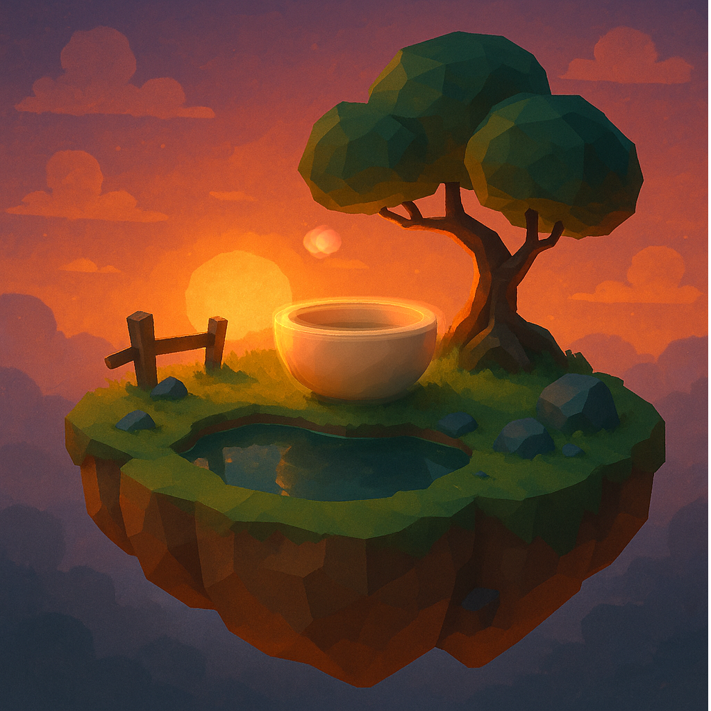

## Suika Game in 4D!

 

This repository was originally forked from the LearnOpenGL [github repo](https://github.com/JoeyDeVries/LearnOpenGL). The current renderer is a fullscreen 4D raymarched SDF scene.

The itch.io page is [here](https://werus23.itch.io/4d-suika).

# Demo & screenshots

[](https://youtu.be/5Bj0ZGDzans "4D Suika Game | Video Demo")

| | |
|:-------------------------:|:-------------------------:|
| |  |
| |  |

<!-- <object width="425" height="350">
  <param name="movie" value="https://youtu.be/5Bj0ZGDzans" />
  <param name="wmode" value="transparent" />
  <embed src="https://youtu.be/5Bj0ZGDzans"
         type="application/x-shockwave-flash"
         wmode="transparent" width="425" height="350" />
</object> -->

## Prerequisites

### Windows
1.  **CMake**: Install via PowerShell: `winget install kitware.cmake` OR download from [cmake.org](https://cmake.org/download/) (ensure "Add to PATH" is selected).
2.  **C++ Compiler**: 
    - **Recommended**: Install [Visual Studio Community](https://visualstudio.microsoft.com/vs/community/) and select **"Desktop development with C++"**.
    - **Alternative**: Install [MSYS2](https://www.msys2.org/) and run `pacman -S mine-w64-x86_64-toolchain`.

### macOS
Install dependencies via Homebrew:
```bash
brew install cmake emscripten glfw sdl2-compat sdl2_mixer freetype glm
```

### Linux (Ubuntu/Debian)
```bash
sudo apt update
sudo apt install cmake build-essential libx11-dev libxcursor-dev libxinerama-dev libxrandr-dev libxi-dev libasound2-dev libmesa-dev libglu1-mesa-dev
```

## Quick Start (Local)
The project now uses a simplified build process with automated dependency management.

### Windows
To build and run on Windows (PowerShell):
```powershell
.\build.bat
.\build.bat run
```

### macOS / Linux
To build and run:
```bash
make build
make run
```

### Recording a trailer
`4d_game --headless --record dir --camera-path file` dumps deterministic fixed-timestep frames (F9 records a live game), and `make video` stitches them with ffmpeg. See [docs/recording.md](docs/recording.md).

### Scripted playtest
`4d_game --headless --mute --playtest-seconds 600` runs ten simulated minutes of deterministic drops while rotating through 4D and prints placement, merge, loss, and score stats.

## Platform-Specific Building (CI/CD)
GitHub Actions builds `4D-Suika-<version>-windows.zip` and `4D-Suika-<version>-macos.zip` (one universal app for Apple Silicon and Intel) on every push. In CI `SUIKA_PORTABLE` is on: every dependency is built from source and linked statically. `cmake/smoke-zip.cmake` (on with `-DSUIKA_SMOKE=ON`, and in macOS CI) unpacks the zip after cpack, checks its layout and runs a 120 s scripted playtest from it (`SUIKA_SHIPPED=1` so the game ignores the source tree). GitHub's runners have no usable OpenGL (macOS only gets the layout check), so run the playtest on real machines before a release: `4d_game --headless --mute --playtest-seconds 120`. A `v*` tag also attaches both zips to a GitHub release; tags publish to players, so only on the PI's word. The game finds `resources/` next to the executable or inside the app bundle, wherever the zip is unpacked.

### Manual Build
If you prefer manual building with CMake:
```bash
cmake -S . -B build -DCMAKE_BUILD_TYPE=Release
nice -n 10 cmake --build build --config Release -j 4
```


# Asset Credits

credit to Chris Haugen for the theme (Morning Mandolin)[https://www.youtube.com/watch?v=jDQgLlmCivI]
